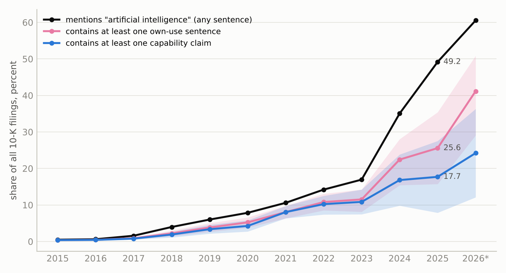
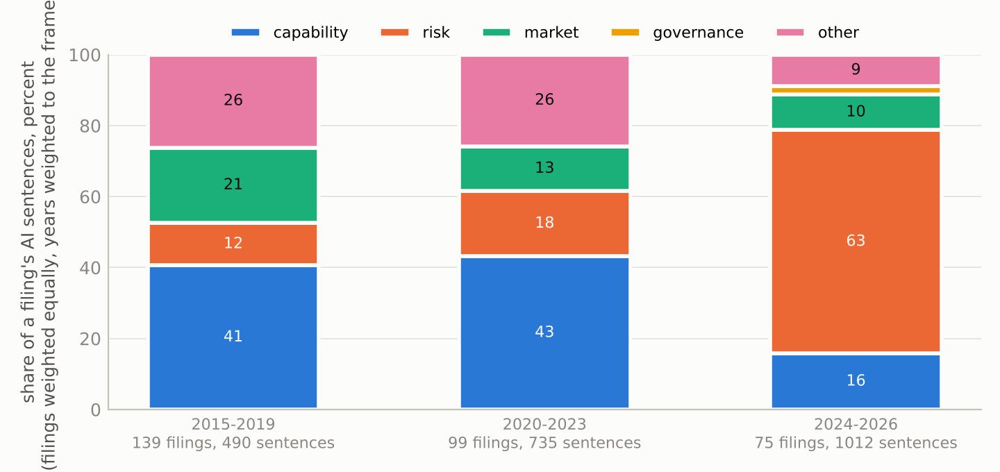
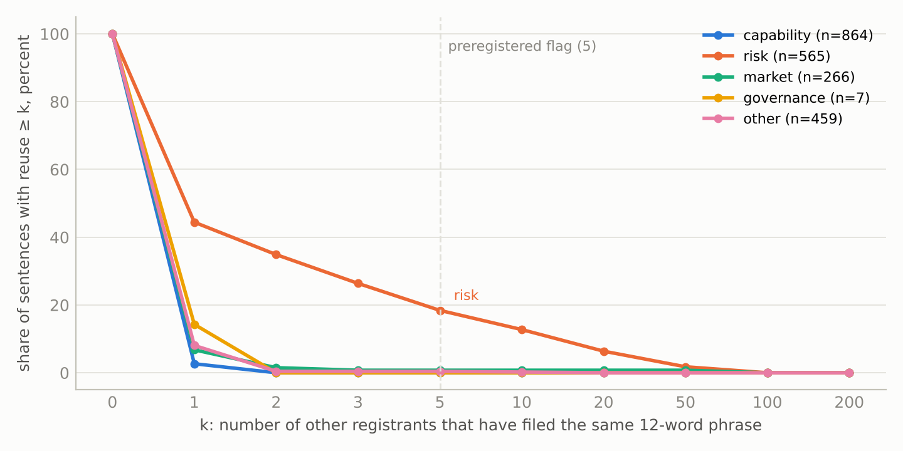

# The Boilerplate Decade

How much of the rise in artificial-intelligence language in Form 10-K annual
reports, 2015 to 2026, is substantive, and how much is boilerplate. A
preregistered, blinded measurement audit with a cross-filer phrase-reuse detector.

**Paper:** [`paper/ai-disclosure-trend-audit.pdf`](paper/ai-disclosure-trend-audit.pdf) ·
**Preregistration:** [`docs/PREREGISTRATION.md`](docs/PREREGISTRATION.md) ·
**Every sentence and verdict:** [`docs/browser.html`](docs/browser.html) ·
**Companion study (2025 only):** [ai-claims-audit](https://github.com/ishaanshah101/ai-claims-audit)

---

## The result

The share of 10-K filings that mention "artificial intelligence" rose from 0.50
percent in 2015 to 49.2 percent in 2025 and 60.5 percent in 2026 to date, a 99-fold
increase. That count is widely read as an adoption curve. Across 315 sampled filings
and 2,242 AI sentences, each rated twice blind with a third pass on disagreements:

| | 2015 to 2019 | 2020 to 2023 | 2024 to 2026 |
|---|---:|---:|---:|
| share of a filing's AI sentences that are **risk-factor language** | 12.0% | 18.4% | 63.0% |
| share that **claim a capability** of the filer's own AI | 40.6% | 43.1% | 15.7% |
| share that **state any use** of AI by the filer | 51.5% | 54.4% | 31.2% |
| AI sentences per AI-mentioning filing (mean, median) | 3.9, 2 | 8.0, 3 | 13.7, 6 |
| **filings** that state their own use of AI somewhere | 61.6% | 71.9% | 61.5% |
| overstatement factor (mention share ÷ own-use share) | 1.62 | 1.39 | 1.63 |

Filings are weighted equally within year and years are weighted to the frame
(Amendment 6, a post hoc correction after an independent check of the first draft,
with the unweighted pooled-sample figures published beside these in
`results/analysis_unweighted.json`).

The language inverted: the risk share rose by 51 percentage points (bootstrap
interval 41 to 61) and the composition shift survives a blinded calibration. The
filers did not: about three in five AI-mentioning filers state their own use of AI
in every era, with no detectable trend. So a count of filings mentioning AI is
still a usable adoption measure once divided by a factor between 1.4 and 1.6, and a
count of AI sentences or words is not. Scaled by each year's sampled fraction, 25.6
percent of all 10-K filers stated their own use of AI in 2025 (interval 15.7 to
35.4, the year with the lowest sampled fraction) and 41.2 percent (29.1 to 50.8) in
2026, against raw shares of 49.2 and 60.5 percent.





**Boilerplate as verbatim reuse is rare and almost entirely risk language.** For
every corpus sentence, the number of other registrants whose 10-Ks contain the same
twelve-word phrase was measured against all of EDGAR. 84.8 percent of AI sentences
are used by no other registrant. 18.4 percent of risk sentences are shared with
five or more others against none of 864 capability sentences, so the flag identifies
risk language with 96 percent precision and 18 percent recall. The flagged share of
a filing's AI sentences rose from 0.0 percent in 2015 to 2019 to 12.3 percent in
2024 to 2026.



## How it was done

1. **Frame.** Every original 10-K whose main document matches the exact phrase
   "artificial intelligence" in EDGAR full-text search, for each calendar year 2015
   to 2026 (through 18 October): 13,586 filings out of 82,684 10-Ks, enumerated
   completely. `src/frame.py`, `src/denominators.py`.
2. **Sample.** One filing per registrant, simple random sample within year under
   seed 20261018: 30 filings in each of 2015 to 2017, 25 in each year after. 315
   filings, 281 registrants.
3. **Extraction.** The companion study's deterministic splitter and rules, with the
   term list changed in the two preregistered ways. 2,590 sentences, of which 348 that
   mention AI only through a registrant's own name (C3.ai, Spectral AI, SES AI,
   Artificial Intelligence Technology Solutions) were removed by two mechanical
   screens plus a blinded read.
4. **Rubric.** The companion's five classes verbatim (capability, risk, market,
   governance, other) plus one new binary, `own_use`: does the sentence state that
   the registrant itself uses, develops or offers AI.
5. **Blinding.** Registrant name and ticker redacted, seeded shuffle across filings
   and years, each sentence to two of six rater identities. The literal prompt is in
   `docs/RATER_PROMPT.md`, committed before dispatch.
6. **Controls, third pass, calibration.** 30 known-answer sentences from the
   companion's calibration key (60 of 60 correct). 155 disputed sentences rated a
   third time by a different model tier, mixed with 155 agreed sentences. 120
   sentences re-read blind by the orchestrating model with 10 duplicates
   (survival 90.0 percent, and all four overturned capability calls went to other,
   as in the companion). Forward-transfer correction reported beside the raw
   composition rates.
7. **Statistics.** Wilson intervals, a percentile bootstrap resampling filings
   within year with design weights, 10,000 replicates, cluster-robust logistic
   regressions, and everything on two bases (agreed only, majority of three) and
   two weightings (sentence, filing).

## Agreement

94.6 percent observed agreement on the five-class task over 2,242 sentences,
Krippendorff's alpha 0.924, and 97.7 percent and 0.952 on own use. 121 class
disagreements, 73 of them capability against other. Era cues leak the period for
6.7 percent of sentences and a registrant-name token survives in 3.7 percent, and
neither raised agreement.

## Preregistered predictions

| | prediction | outcome |
|---|---|---|
| 1 | risk share higher in 2024 to 2026 than 2015 to 2019 | held, +51 points (41 to 61) |
| 2 | own-use share lower | held, −20 points (−32 to −8) filing-weighted, interval includes zero sentence-weighted |
| 3 | fewer than 60% of AI-mentioning filings contain any own-use sentence | **failed**, 61.3% (50.0 to 71.5) |
| 4 | risk reuse at least 3× capability by median AND flag rate at least 2× | held on one of two criteria: median undecidable (both zero), flag criterion held, 18.4% vs 0% |
| 5 | flagged share rises | held, +12.3 points (7.4 to 17.7) |
| 6 | overstatement factor larger in the last era | **not supported**, 1.63 vs 1.62, interval −0.43 to +0.43 (unweighted it was 1.63 vs 1.51) |
| 7 | technology registrants have higher own-use rate | held, +27 points (14 to 39), +19 unweighted |

Four held with intervals clear of zero, one held on one of two criteria, one not
supported, one failed. Six amendments, a record of deviations and one note, each
dated and with its reason, are at the bottom of the preregistration. Amendments 3
and 6, the two weighting decisions, were made after the ratings, and the
preregistration says so.

## Reproducing it

```bash
pip install -r requirements.txt
./run_all.sh                    # analysis from the committed judgements
REBUILD_CORPUS=1 ./run_all.sh   # re-enumerate EDGAR and rebuild the corpus
./paper/build.sh                # rebuild the PDF (pandoc + xelatex)
```

`src/verify_paper.py` recomputes the headline era estimates, the filing-level
fractions and the corpus counts directly from the committed labels, checks every
other number quoted in the paper against `results/analysis.json`, and exits non-zero
on any mismatch. It runs **321 checks with zero failures**, including that the three
sentences quoted verbatim appear in the corpus and were filed by the companies
named. An earlier version caught two attribution errors in the draft, and an
independent check of the first draft found the weighting problem that Amendment 6
corrects.

## Layout

```
src/frame.py              enumerate the twelve yearly frames
src/denominators.py       count all 10-Ks per year from the EDGAR full index
src/sample_filings.py     seeded draw, one filing per registrant per year
src/fetch_and_extract.py  download main documents, split, extract AI sentences
src/term_audit.py         name-only and entity-suffix screens, apply verdicts
src/build_rating_sets.py  redact, shuffle, assign, insert controls
src/rating_status.py      which batches still lack output
src/validate_ratings.py   schema-check all 5,240 judgements
src/agreement.py          agreement, alpha, controls, leakage
src/third_pass.py         build and merge the third pass
src/build_calibration.py  build and score the blinded calibration
src/phrase_reuse.py       cross-filer phrase reuse against all of EDGAR
src/xbrl_size.py          total assets per filing from the XBRL API
src/analyze.py            every number in the paper
src/figures.py            figures
src/build_browser.py      the sentence browser page
src/verify_paper.py       recompute the headline numbers, check every quoted one, fail loudly
src/stats.py              Wilson, alpha, bootstrap helpers, self-checks

data/frame.json           all frame filings, twelve years, with raw hits
data/denominators.json    10-K counts per year
data/sample_filings.json  the 315 drawn filings
data/sentences.json       the 2,590 extracted sentences with term-audit flags
data/term_audit_*.json    screen candidates and the blinded verdicts
data/rating/              blinded items, all 108 batch files and outputs,
                          controls key, labels, third-pass sets and outputs
data/calibration/         blinded materials, key, reviewer judgements
data/phrase_reuse.json    reuse counts, L=12 (and phrase_reuse_L8.json)
data/phrase_pilot.json    the window-length pilot on the companion corpus
data/xbrl_size.json       total assets per filing
data/btos/                Census BTOS sector file and the extracted AI series
results/                  agreement.json, calibration.json, analysis.json,
                          analysis_unweighted.json (pooled-sample comparison)
data/companion_values.json the companion study's figures used for comparison
docs/PREREGISTRATION.md   written before sampling, with dated amendments
docs/RATER_PROMPT.md      the literal rater prompt, committed before dispatch
docs/PHRASE_PILOT.md      the pilot that fixed the window length
docs/REFERENCES_VERIFIED.md every reference, with the record it was checked against
docs/browser.html         every sentence with its verdicts, filterable
```

Raw 10-K documents (about 1.5 GB) are not committed, and `src/fetch_and_extract.py`
reproduces them from the accession numbers in `data/sample_filings.json`.

## A note on the raters

The rating passes, the third pass, the term-audit read and the calibration reviewer
are language models, not people: six rater identities, each a separate instance of
a mid-sized commercial model, two per sentence, for the blind passes, one more
instance of that model for the term-audit read, a larger model from the same family
for the third pass, and the largest model in that family, which orchestrated the
study, for the calibration review.
Model identities and versions are recorded in a private model log and are available
from the author. No figure here should be read as human inter-rater agreement.
Every sentence and every judgement is published so that a reader who disputes a call
can look at the sentence and say so.

## License

MIT, see [LICENSE](LICENSE). SEC filings are public domain works of the United States
government, and sentences quoted from them are reproduced for analysis. Census BTOS data
are public.
