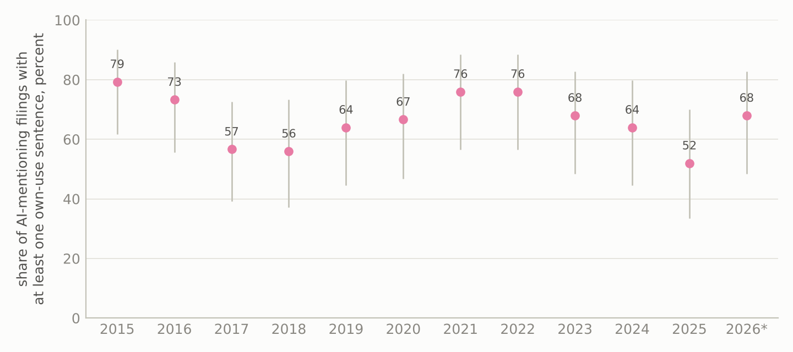
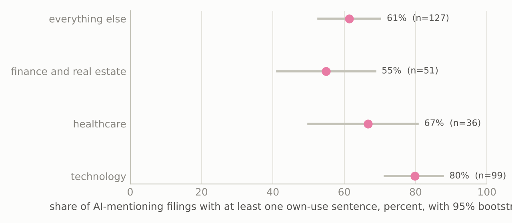
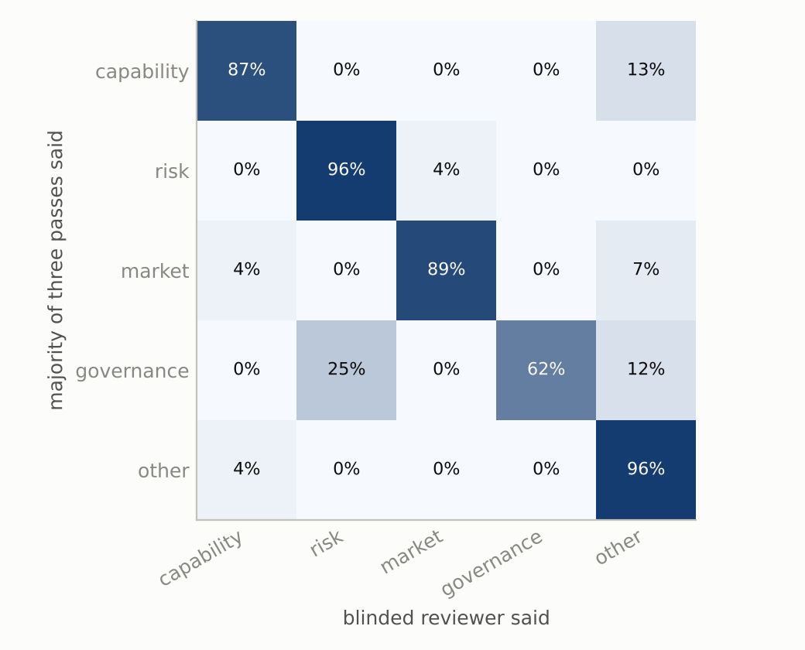

## Abstract

The share of Form 10-K annual reports that contain the phrase "artificial
intelligence" rose from 0.50 percent in 2015 to 49.2 percent in 2025 and to 60.5
percent of the filings made in 2026 through 18 October, a 99-fold increase in a
decade. That count is used, by researchers, by index providers and by the financial
press, as a measure of how far AI has spread through public companies. This paper
measures what the count is counting. Under a preregistration committed before any
sample was drawn, 315 filings were sampled across the twelve calendar years from
2015 to 2026, every AI sentence in them was extracted by a fixed splitter, and the
2,242 sentences that survived a term audit were each classified by two independent
blinded language-model passes against a rubric reused unchanged from a companion
study of 2025 filings, with a third pass on every disagreement, thirty known-answer
controls, and a blinded calibration review.

The composition of AI language changed completely. Weighting filings equally, the
share of a filing's AI sentences that are risk-factor language rose from 7.5 percent
in 2015 to 2019 to 62.9 percent in 2024 to 2026, a change of 55.4 percentage points
with a bootstrap interval from 46.8 to 63.7, while the share that claims a capability
of the registrant's own AI fell from 47.3 to 16.9 percent and the share that states
any use of AI by the registrant fell from 56.8 to 32.4 percent. The composition shift
survives calibration. At the filing level the picture is different: the fraction of
AI-mentioning filers that state their own use of AI somewhere in the document has
stayed near two thirds throughout, 66.2, 71.7 and 61.3 percent across the three eras,
so a mention still usually comes with an own-use statement, but it now arrives inside
a much larger body of defensive text. Correcting the raw count by that fraction puts
the share of all 10-K filers stating their own use of AI at 25.6 percent in 2025
rather than 49.2, and the share making a capability claim at 17.7 percent.

A computational boilerplate detector, the number of other registrants whose 10-Ks
contain the same twelve-word phrase, measured against the whole EDGAR corpus for
every sentence, finds that verbatim cross-filer reuse is rare but almost entirely
confined to risk language: 18.4 percent of risk sentences are shared with five or
more other registrants against none of 864 capability sentences, and the flagged
share of all AI sentences rose from zero in 2015 to 2019 to 10.2 percent in 2024 to
2026. Five of seven preregistered predictions held, one held on its point estimate
only, and one failed at its stated boundary. All sentences, judgements, prompts and
code are published.

## 1. Introduction

Counting how many annual reports mention artificial intelligence is the cheapest
measure of corporate AI adoption there is. The phrase is unambiguous, the filings are
public, and EDGAR's full-text search returns the count in under a second. The count
has also risen in a way that invites a story: fewer than one filing in two hundred
mentioned the phrase in 2015, and more than one in two did in 2025. Whoever reads
that series as a diffusion curve is treating a mention as an adoption.

This paper asks whether that reading is honest, and how its honesty has changed over
time. There are two ways it could fail. A filing can mention AI only to say that AI
is a risk, that competitors have it, that regulators are interested in it, or that the
board has a policy about it, and none of those is an adoption. And even a filing that
does state its own use of AI can surround that statement with so much defensive
language that the count of AI sentences in filings says more about the drafting
conventions of securities counsel than about the technology. The first failure is
about what fraction of filers are counted wrongly. The second is about what fraction
of the language is counted wrongly. They have different consequences for different
users of the measure, and the paper measures both.

The design is a direct extension of a companion study I ran in September 2026 on 60
annual reports filed in 2025 (Shah 2026b). That study found that a calibrated 60.5
percent of AI sentences were risk-factor language and 12.2 percent were claims about
the registrant's own AI, and it closed with three things it could not do: say anything
about trend, publish the literal prompts given to its rating passes, or detect
boilerplate without a model reading every sentence. This study adds eleven years, a
committed prompt, a computational detector, and one additional judgement, whether the
sentence states that the registrant itself uses AI, that the adoption literature needs
and the companion's rubric did not record. The rubric, the splitter and the extraction
rules are otherwise reused without change, so the 2025 result can be compared
directly.

The answer, in one paragraph, is that both failures are real and they have moved in
opposite directions. The language has diluted dramatically: a typical AI-mentioning
filing in 2015 to 2019 spent half of its AI sentences describing what its own AI did
and one in thirteen describing risk, and a typical filing in 2024 to 2026 spends one
sixth on capability and nearly two thirds on risk. The filers have not: about two
thirds of AI-mentioning filers state their own use of AI somewhere in the document in
every era, with no detectable trend. So a sentence count of AI language has become a
poor proxy for adoption, a filing count remains a usable proxy once scaled by a
roughly constant factor of about 1.5, and the paper reports that factor with its
uncertainty for every year.

## 2. Related work

The textual-analysis literature in accounting and finance has long warned that a
word count built for one purpose will be wrong in systematic ways when used for
another. Loughran and McDonald (2011) showed that general-purpose sentiment
dictionaries misclassify financial language and built finance-specific lists;
their 2016 survey argues that textual measures are far less precise than the
quantitative measures they are placed beside and catalogues the implementation
tripwires. Dyer, Lang and Stice-Lawrence (2017) documented that 10-K length,
boilerplate, stickiness and redundancy all rose between 1996 and 2013 and that a
handful of topics, risk factors prominent among them, account for most of the
growth. Lang and Stice-Lawrence (2015) built the standard boilerplate measure from
four-word phrases that recur across a country's filings. Cazier and Pfeiffer (2016)
partitioned 10-K length into complexity, redundancy and discretion. Brown and
Tucker (2011) showed that year-over-year modification of the MD&A declined even as
the section grew. Hoberg and Phillips (2016) are the canonical example of a
measure built from 10-K text that was validated against something outside the
text. This paper sits in that tradition: it takes a text-based measure that is
already in wide informal use and asks what it is measuring.

On risk-factor disclosure specifically, Campbell et al. (2014) found that mandated
risk factors carry firm-specific information, and Hope, Hu and Lu (2016) found that
specific risk-factor language is rewarded while generic language, which practitioners
had long called boilerplate, is not. Redigolo and Marcarini (2026) is the closest
precedent for the trend question: for Item 1A risk factors from 2019 to 2024 they
detect a jump in AI-generated text after ChatGPT and find it more standardised and
less specific. Their object is who wrote the risk factors; mine is what share of the
AI language the risk factors have become.

On AI adoption measurement, Babina, Fedyk, He and Hodson (2024) measure AI investment
from employee resumes, Eisfeldt, Schubert and Zhang (2023) from occupational exposure,
Li (2025) contrasts AI talk on earnings calls with AI walk in hiring and finds that
talk does not predict walk, Barrios, Campbell, Johnson and Liu (2025) find that AI
disclosures drawn from 10-Ks, earnings statements and calls do predict later
efficiency and patents, Liu (2024) builds a firm-level exposure measure from
managerial discussion, Akbari (2026) dates each firm's shift from AI talk to
deployment from call transcripts, and Juma'h (2026) finds vague and promotional AI
language in the 10-Ks of AI-driven firms. Zhang and Rivera (2026) and Ofir (2026)
treat AI washing as a governance and legal problem respectively. Outside filings,
Bonney et al. (2024) and McElheran et al. (2024) measure AI use from Census Bureau
surveys, and the Business Trends and Outlook Survey now publishes a fortnightly AI-use
rate. The literature verifier for this paper could not find a peer-reviewed paper
whose abstract describes counting "artificial intelligence" mentions in 10-Ks as its
adoption measure, which is itself worth stating: the count is used far more often in
practice than it is defended in print.

On language models as annotators, Gilardi, Alizadeh and Kubli (2023) found that
zero-shot ChatGPT beat crowd workers on text-annotation accuracy and agreement, de Kok
(2025) gives a framework for generative models in accounting text work, Hansen and
Kazinnik (2023) and Jha et al. (2024) validate model-coded measures against human and
survey benchmarks. This study follows the companion's position that model passes must
be checked against known answers and a blinded review rather than trusted.

## 3. Data

### 3.1 The frame and the denominator

For each calendar year from 2015 to 2026, the frame is every original Form 10-K
(not an amendment) whose main document matches the exact phrase "artificial
intelligence" in EDGAR full-text search, with the 2026 frame running through 18
October, the day the preregistration was written. EDGAR returns one hit per
document, so hits were collapsed to filings by accession number and restricted to
filings in which the 10-K document itself matched rather than only an exhibit. The
restriction matters at the margin: in 2025 it turns 3,324 raw hits, the figure the
companion study enumerated, into 3,162 original filings from 3,153 registrants.
Both counts are published. The denominator is the number of filings of form type
exactly 10-K in the EDGAR full index for the same year. Across the twelve years the
frame holds 13,586 filings out of 82,684 10-Ks.

Table 1 gives the series. The raw share rises in every year, from 0.50 percent in 2015
to 16.9 percent in 2023, then jumps to 35.0 percent in 2024, 49.2 percent in 2025 and
60.5 percent in 2026 to date. The 2024 jump is the year in which filings for fiscal
2023, the first full fiscal year after the release of ChatGPT, were made.

| year | frame | all 10-Ks | raw share |
|---|---:|---:|---:|
| 2015 | 38 | 7,659 | 0.50% |
| 2016 | 45 | 7,259 | 0.62% |
| 2017 | 110 | 6,984 | 1.58% |
| 2018 | 271 | 6,827 | 3.97% |
| 2019 | 400 | 6,660 | 6.01% |
| 2020 | 511 | 6,508 | 7.85% |
| 2021 | 734 | 6,933 | 10.59% |
| 2022 | 1,071 | 7,538 | 14.21% |
| 2023 | 1,206 | 7,118 | 16.94% |
| 2024 | 2,324 | 6,631 | 35.05% |
| 2025 | 3,162 | 6,431 | 49.17% |
| 2026 to 18 Oct | 3,714 | 6,136 | 60.53% |

Table 1. Original 10-K filings whose main document contains "artificial
intelligence", all original 10-K filings, and the raw mention share, by calendar
year of filing.

### 3.2 The sample

Within each year the frame was collapsed to one filing per registrant and a simple
random sample of registrants was drawn under seed 20261018: 30 filings in each of
2015, 2016 and 2017, where filings contain few AI sentences, and 25 in each year from
2018 to 2026, 315 filings from 281 distinct registrants, 29 of which were drawn in more
than one year. The draw was not stratified by sector, so that the sample's sector mix
tracks the frame's. That mix is itself part of the story: technology registrants were
42 percent of the frame in 2015 to 2019 and 16 percent in 2024 to 2026, as AI language
spread from the companies that sell it to everyone else.

### 3.3 Extraction and the term audit

Each main document was downloaded, stripped of markup and split by the companion's
deterministic sentence splitter. A sentence entered the corpus if it matched the AI
term list, was between 60 and 1,200 characters, and was less than a quarter digits.
The term list differs from the companion's in exactly the two ways the preregistration
specified, both responses to false positives the companion documented: the pattern for
the abbreviation ML was dropped because it matched millilitres, and the standalone
abbreviation AI was matched case-sensitively. All 315 filings downloaded without
error and yielded 2,590 sentences.

The letters AI inside a registrant's own name are the largest remaining false
positive, and four sampled registrants carry them, one of which, C3.ai in 2023,
contributed 448 extracted sentences. Two mechanical screens found 357 candidates: 353
sentences in which no AI term survives once the registrant's own name is removed,
which is the same redaction the raters see, and four in which the abbreviation is
followed by a corporate suffix or sits in a list of entity names. A blinded read of
all 357 by a separate model instance confirmed 348 as containing no reference to AI
other than through a name and kept nine that also mentioned machine learning models or
similar. The 348 are removed from every denominator, leaving 2,242 corpus sentences in
313 filings, a median of 3 per filing and a maximum of 154, from the C3.ai filing,
which is 6.9 percent of the corpus. Because one filing can carry that much weight,
every sentence-level rate is reported twice: weighting every sentence equally, which is
what the preregistration implied, and weighting every filing equally, which Amendment
3 added as the primary presentation for exactly this reason. The two agree in
direction everywhere and the filing-weighted numbers are the ones quoted in the text.

The blinded read also surfaced a false positive the screens cannot catch: one
sentence uses "an AI" to mean an aromatase inhibitor, a breast-cancer drug. It was
rated as other by both passes and stays in the corpus, which is the correct treatment
under the preregistered rules and a reminder that a case-sensitive two-letter pattern
is still a two-letter pattern.

## 4. Method

### 4.1 The rubric

Part A assigns each sentence exactly one of the companion's five classes, with the
companion's definitions verbatim: `capability` if the sentence asserts that the
registrant's own product, service or operation uses AI and attributes a capability,
benefit, efficiency or performance level to it; `risk` for risk-factor language;
`market` for AI in the industry, the market or at competitors; `governance` for
policy, board oversight, internal controls or responsible-use programmes; and `other`
for definitions, cross-references, boilerplate and anything else, including a
sentence that says the registrant uses AI without saying what the AI achieves.

Part B is new. `own_use` is true when the sentence states that the registrant itself
currently uses, deploys, offers, licenses, develops, trains or is implementing AI in
its own products, services, operations or research, whether or not a benefit is
attributed, and false for hypothetical or conditional use, for statements about other
companies or the industry, for pure definitions, and for risk language that does not
assert actual use. A risk sentence that asserts use in passing, "our use of AI in
underwriting exposes us to model risk", is true. This is the adoption-relevant
judgement: the companion found that the capability calls its reviewer overturned were
sentences saying a company uses AI without saying what it achieves, which the rubric
sends to `other`, and those are exactly the sentences an adoption measure should
count.

### 4.2 Blinding and passes

Raters saw the sentence text and nothing else. The registrant's name, with any
punctuation or spacing between its tokens, and its ticker were replaced, except that a
ticker which is itself an AI term (C3.ai trades as AI) was left alone so as not to
erase the term being rated. Sentences were shuffled across filings and years under a
fixed seed. Each sentence was assigned to two of six rater identities by cycling the
fifteen rater pairs through the shuffled order. The raters were independent instances
of Claude Sonnet 5.5 dispatched in batches of fifty with the literal prompt that is
committed in `docs/RATER_PROMPT.md`, which closes the gap the companion reported.
Thirty known-answer controls, sentences from the companion's calibration set whose
class a blinded reviewer had fixed in September 2026 and whose automated passes had
agreed, were inserted unmarked.

Every sentence on which the two passes disagreed on class or on own use, 155 in all,
was rated a third time by Claude Opus 5.5, blind to the prior verdicts and to the fact
of disagreement, mixed with 155 agreed sentences drawn at random so that selection
could not reveal which were disputed. Composition is reported on two bases: agreed
only, with the disputed set shown as a bound, which is the companion's convention, and
majority of three.

### 4.3 Calibration

A seeded sample of 120 sentences stratified over the five majority classes and three
eras, with ten duplicated under second identifiers, was re-read blind by the
orchestrating model, Claude Fable 5.1, which recorded a class and an own-use judgement
for all 130 displays before the key was opened. The survival rate of each class and
each own-use value was measured, and every composition rate was corrected by the
companion's forward-transfer method, with the correction's uncertainty obtained by
resampling the calibration units jointly with the filings. Corrected and uncorrected
rates are both reported.

### 4.4 The phrase-reuse measure

For every corpus sentence, a core phrase was formed by lower-casing the sentence,
tokenising it the way the search index does, and taking the twelve consecutive tokens
starting at the first AI term, shifted left if the sentence ended first and moved
right by up to five tokens to avoid digits and apostrophes. The phrase was submitted
to EDGAR full-text search as an exact phrase over all 10-K filings since 2001, and
the number of other registrants whose filings contain it, `reuse_ciks`, was recorded,
with pagination past the search engine's thirty-bucket entity aggregation whenever a
phrase reached it. The preregistered boilerplate flag is five or more other
registrants. A window of twelve was fixed by a pilot on twenty sentences from the
companion's published corpus before any corpus sentence was queried; a sensitivity run
at eight words is reported alongside.

### 4.5 Statistics

Proportions carry Wilson score intervals. All sentence-level and filing-level
uncertainty comes from a percentile bootstrap that resamples filings, within year or
era where the estimate is yearly or by era, 10,000 replicates under a fixed seed,
vectorised over per-filing count vectors. Era contrasts resample the two eras
independently. The corrected adoption share for a year is the raw mention share
times the sampled proportion of AI-mentioning filings with at least one own-use (or
capability) sentence, and the overstatement factor is the reciprocal of that
proportion. Trend is summarised by Spearman's rank correlation between year and the
yearly estimate and by sentence-level logistic regressions on calendar year with
standard errors clustered by filing. `src/stats.py` carries self-checks, including
two published Wilson values and a cross-check of the Krippendorff alpha
implementation against the reference package.

### 4.6 Who the raters are

The raters, the third pass and the calibration reviewer are language models: Claude
Sonnet 5.5 for the two blind passes, Claude Opus 5.5 for the third pass, and Claude
Fable 5.1, which orchestrated the study, for the calibration review and the blinded
read of the term-audit candidates. Nothing in the paper should be read as human
inter-rater agreement. What is measured is whether independent protocol-driven passes
reach the same classification, how they perform on sentences with a previously fixed
answer, and how far they survive review by a more careful pass. Every sentence and
every judgement is published.

## 5. Results

### 5.1 The passes agree, pass the controls, and leak a little

Across the 2,242 corpus sentences the two blind passes assigned the same class 2,121
times, an observed agreement of 94.6 percent with a Krippendorff alpha of 0.924,
against 93.1 percent and 0.879 in the companion. On own use they agreed 97.7 percent of
the time with an alpha of 0.952. Of the 121 class disagreements, 73 are capability
against other, the boundary between using AI and saying what it achieves, and 21 are
market against other. All 60 judgements on the 30 known-answer controls were correct,
which bounds the error rate on sentences with a fixed answer below 6.0 percent at the
Wilson lower limit. On the 155 agreed sentences mixed into the third pass, the Opus
instance agreed with the two-pass consensus 147 times on class and 152 times on own
use, and it resolved 150 of the 155 disputed sentences to a majority, leaving five with
three different verdicts.

Blinding leaked in two measurable ways. A sentence that says "generative AI" or
"large language model" reveals that it was written after 2022, and 6.7 percent of
sentences carry such a cue; agreement on them was 93.4 percent against 94.7 percent on
the rest. A distinctive token of the registrant's name survived redaction in 3.7
percent of sentences, with agreement of 91.5 percent against 94.7. Neither leak helped
the raters agree.

### 5.2 The composition of AI language has inverted

{width=92%}

Figure 1 and Table 2 give the composition by era, weighting filings equally. In 2015
to 2019 a typical AI-mentioning filing devoted 47.3 percent of its AI sentences to
claims about its own AI's capability, 29.2 percent to other, 16.1 percent to the
market and 7.5 percent to risk. In 2024 to 2026 the same filing devotes 62.9 percent to
risk, 16.9 percent to capability, 9.2 percent to the market and 8.8 percent to other.
Governance, absent before 2024, reaches 2.3 percent. The risk share rose by 55.4
percentage points with a bootstrap interval from 46.8 to 63.7, the capability share
fell by 30.4 points (interval 21.2 to 39.7), and the own-use share fell from 56.8 to
32.4 percent, a drop of 24.4 points (14.0 to 34.7). Spearman's correlation between year
and the yearly risk share is 0.937, and in a sentence-level logistic regression with
filing-clustered errors the odds that an AI sentence is risk language rise by a factor
of 1.52 per calendar year while the odds that it is a capability claim fall by a
factor of 0.88 and the odds that it states own use fall by 0.92.

| | 2015 to 2019 | 2020 to 2023 | 2024 to 2026 |
|----------------------|------------------:|------------------:|------------------:|
| filings, sentences | 140, 490 | 100, 735 | 75, 1,012 |
| capability | 47.3 (40.0, 54.5) | 42.1 (34.7, 49.6) | 16.9 (11.4, 22.6) |
| risk | 7.5 (3.8, 11.7) | 18.6 (12.1, 25.6) | 62.9 (55.2, 70.2) |
| market | 16.1 (11.1, 21.5) | 13.6 (8.8, 19.0) | 9.2 (4.7, 14.4) |
| governance | 0.0 | 0.0 | 2.3 (0.3, 5.4) |
| other | 29.2 (22.9, 35.7) | 25.7 (19.1, 32.6) | 8.8 (6.3, 11.5) |
| own use | 56.8 (49.4, 64.0) | 53.6 (45.7, 61.5) | 32.4 (25.1, 39.6) |
| sentences per filing | 3.5 | 7.4 | 13.5 |

Table 2. Share of a filing's AI sentences in each class and the share stating the
registrant's own use, percent, filings weighted equally, majority-of-three labels, with
95 percent bootstrap intervals resampling filings.

Weighting every sentence equally instead, which lets the heaviest filers dominate,
gives the same ordering with smaller magnitudes: the risk share rises from 5.7 to 45.6
percent (a change of 39.8 points, interval 31.1 to 49.3) and the own-use share falls
from 65.2 to 52.1 percent (13.2 points, 1.6 to 26.0). On the agreed-only basis the
filing-weighted era shares are within four points of the majority basis everywhere.

The inversion has two components, and the data separate them. One is who mentions AI.
Technology registrants were 42 percent of the frame in the first era and 16 percent in
the last, and their filings are far more likely to describe a product: the
filing-weighted capability share is 45.8 percent at technology registrants against
32.3 percent in finance and real estate, and the risk share is 12.7 percent against
32.8. The other is how much each filer says. A typical AI-mentioning filing carried 3.5
AI sentences in 2015 to 2019 and 13.5 in 2024 to 2026, and nearly all of the added
volume is risk language. The 2015 corpus contains sentences like iCAD's "SecondLook
detects and identifies suspicious masses and micro-calcifications utilizing image
processing, pattern recognition and artificial intelligence techniques" and CorVel's
"CorVel's artificial intelligence engine includes over sixty million individual rules,
which creates a comprehensive review process that is more efficient than traditional
manual bill review processes." The 2026 corpus contains Olema Pharmaceuticals' "If we
are unable to use generative AI, it could make our business less efficient and result
in competitive disadvantages", a sentence whose core phrase appears in the 10-Ks of 87
other registrants.

### 5.3 The filers have not changed much

{width=88%}

The filing-level question is whether a filing that mentions AI says, anywhere, that it
uses AI. Across the 313 filings with at least one corpus sentence, 66.8 percent do
(interval 61.5 to 72.0), and 57.8 percent make at least one capability claim. By era
the own-use fraction is 66.2, 71.7 and 61.3 percent (Figure 2), the late-minus-early
difference is 4.9 points with an interval from 18.3 points down to 8.7 points up, and
Spearman's correlation between year and the yearly fraction is negative 0.21 with p = 0.50. The
yearly fractions sit between 52 and 79 percent on 24 to 30 filings each and their
Wilson intervals all overlap. The capability fraction does fall, from 60.4 to 41.3
percent (interval on the difference 5.3 to 33.3 points), which is the filing-level
trace of the sentence-level shift from describing products to describing risk.

So the two measurement failures diverge. A filing that mentions AI is about as likely
to state its own use of AI in 2026 as it was in 2016, and that likelihood is about two
in three. What has changed is everything around that statement.

### 5.4 The corrected adoption trend

{width=92%}

Figure 3 multiplies the raw series by the sampled fractions. In 2025, 49.2 percent of
10-K filings mentioned AI, an estimated 25.6 percent (interval 15.7 to 35.4) contained
an own-use statement, and 17.7 percent (7.9 to 27.5) contained a capability claim.
Pooling the three eras, the raw share was 2.44, 12.5 and 47.9 percent and the
own-use share 1.6, 9.0 and 29.4 percent. The overstatement factor, raw share over
own-use share, is 1.51 (interval 1.35 to 1.72) in 2015 to 2019, 1.39 (1.25 to 1.60) in
2020 to 2023 and 1.63 (1.39 to 1.97) in 2024 to 2026. It is larger in the last era than
the first on the point estimate, by 0.12, but the interval on that difference runs
from 0.20 down to 0.50 up and 76 percent of bootstrap replicates are positive, so the
growth in overstatement is suggestive and not established. The practical reading is
that the filing count overstates own-use adoption by roughly half, in every era, and
overstates capability-claiming adoption by more in the recent years: the capability
factor is 2.4 in 2024 to 2026 against 1.7 in 2015 to 2019.

| year | raw share | own-use share | capability share | filings |
|------|--------:|--------------------:|--------------------:|------:|
| 2015 | 0.50 | 0.39 (0.32, 0.46) | 0.38 (0.30, 0.45) | 29 |
| 2018 | 3.97 | 2.22 (1.43, 3.02) | 1.91 (1.11, 2.70) | 25 |
| 2021 | 10.59 | 8.05 (6.35, 9.74) | 8.05 (6.35, 9.74) | 25 |
| 2023 | 16.94 | 11.52 (8.13, 14.23) | 10.84 (7.45, 14.23) | 25 |
| 2024 | 35.05 | 22.43 (15.42, 28.04) | 16.82 (9.81, 23.83) | 25 |
| 2025 | 49.17 | 25.57 (15.73, 35.40) | 17.70 (7.87, 27.53) | 25 |
| 2026 | 60.53 | 41.16 (29.05, 50.84) | 24.21 (12.11, 36.32) | 25 |

Table 3. Share of all original 10-K filings, percent, with 95 percent bootstrap
intervals on the sampled fraction. All twelve years are in `results/analysis.json`.

### 5.5 Verbatim reuse is rare, and it is risk language

{width=88%}

All 2,242 corpus sentences were queried without error, 96.5 percent found their own
filing, and 76 returned no hit at all, which marks a normalisation failure rather than
a rare phrase and leaves 2,166 sentences in the reuse analysis. For 84.8 percent of
them, no other registrant has ever filed a 10-K containing the same twelve-word
phrase. Five percent are shared with five or more other registrants and one percent
with thirty or more, up to a maximum of 87. Boilerplate in the sense of verbatim
cross-filer copying is therefore uncommon in AI language at this window length, and
the eight-word sensitivity run moves the flagged share only from 5.0 to 6.2 percent.

What reuse there is sits almost entirely in one class (Figure 4). Of 864 capability
sentences, none is shared with five or more other registrants and 97.3 percent are
shared with none, so the preregistered flag has a Wilson upper bound of 0.4 percent on
capability. Of 565 risk sentences, 104, or 18.4 percent (interval 15.4 to 21.8), are
flagged and 44.4 percent are shared with at least one other registrant, with a 90th
percentile of twelve other registrants. Market and other sentences are flagged at 0.8
and 0.4 percent. As a detector of risk language the flag is almost perfectly specific
and weakly sensitive: 96.3 percent of flagged sentences are risk sentences and 18.4
percent of risk sentences are flagged. As a detector of "not an own-use statement" it
is weak, with an area under the curve of 0.58, because most non-own-use sentences are
also unshared. The eight-word window flags 22.7 percent of risk sentences and 0.1
percent of capability sentences.

The flagged share of all AI sentences is 0.0 percent in 2015 to 2019, 1.0 percent in
2020 to 2023 and 10.2 percent in 2024 to 2026 (interval 7.0 to 13.9), a rise of 10.2
points. The most reused sentences are the generic AI risk factors of the last three
years: the inability to use generative AI (87 other registrants), AI outputs being
deficient or biased (78), competitors incorporating AI faster (74), AI ethics
controversy (68), and the cost of complying with AI regulation (63). The only
non-risk sentences in the top twelve are two filers' copies of the "collectively, AI"
definition that opens many registrants' AI risk factors.

### 5.6 Sectors and size

{width=82%}

Pooling all years, 79.8 percent of technology registrants' AI-mentioning filings
state their own use of AI (79 of 99; interval 71.4 to 87.6), against 66.7 percent in
healthcare (24 of 36), 54.9 percent in finance and real estate (28 of 51) and 61.4
percent in everything else (78 of 127). The difference between technology and the
other three strata pooled is 19.1 points with an interval from 8.6 to 29.2, so
preregistered prediction 7 holds with room to spare. Registrant size, from the total
assets each filing reported to the XBRL API, available for 308 of 315 filings, makes
no difference to the own-use fraction (64.7 percent above the median of about one
billion dollars against 68.0 percent below, difference 3.3 points, interval 13.8 down
to 7.6 up) but a large one to composition: the filing-weighted risk share is 37.1
percent at larger registrants and 12.3 percent at smaller ones, which is consistent
with larger registrants employing the counsel who write the risk factors.

### 5.7 Calibration

{width=58%}

The reviewer was consistent with itself on all ten duplicate controls, on class and on
own use. Of 120 majority verdicts, 108 survived review, 90.0 percent: 96.3 percent of
risk calls (26 of 27), 96.3 percent of other (26 of 27), 89.3 percent of market (25 of
28), 86.7 percent of capability (26 of 30) and 62.5 percent of governance (5 of 8).
Own-use calls survived at 94.4 percent when true and 89.4 percent when false. The
errors have the same direction as in the companion: all four overturned capability
calls went to other, and all four were product-list fragments, service descriptions or
aspirations that name AI without attributing anything to it. Governance, the smallest
class at 0.5 percent of the corpus, is the least reliable, and three of its eight units
went to risk or other. Survival was 91.2 percent in the first era, 94.9 in the second
and 85.1 in the third.

Forward-transfer correction moves the filing-weighted capability share from 47.3 to
42.6 percent in the first era and from 16.9 to 15.3 in the last, and the own-use share
from 56.8 to 58.2 and from 32.4 to 37.7. The risk share barely moves, from 7.5 to 7.2
and from 62.9 to 61.1. The era contrasts after correction are 53.9 points for risk,
27.3 points for capability and 20.5 points for own use, so nothing in Section 5.2
depends on the passes being right.

### 5.8 Replication of the 2025 companion

The 25 filings drawn here for 2025 give a sentence-weighted agreed-basis risk share of
49.5 percent (interval 37.6 to 64.8) and a capability share of 28.5 percent (11.0 to
42.5), where the companion's 60 filings gave 60.5 and 12.2. The companion's values lie
inside both intervals, but the capability point estimate here is more than twice the
companion's. Two things differ. The companion stratified by sector and this study did
not, and 2025 is the single year in which this study's draw is thinnest relative to
the frame. And the two sets of raters sit at slightly different places on the
capability-versus-other boundary, which the calibration surfaces here as a 13 percent
transfer out of capability and the companion reported as 13 percent too. Weighting
filings equally, the 2025 risk share here is 67.5 percent and the capability share 11.2
percent, close to the companion's figures. The honest summary is that the two studies
agree within their uncertainty and that 25 filings is a loose replication.

### 5.9 The preregistered predictions

Prediction 1, that the risk share would be higher in 2024 to 2026 than in 2015 to
2019, held by 55 points with an interval well away from zero. Prediction 2, that the
own-use share would be lower, held by 24 points, also clear of zero. Prediction 3,
that fewer than 60 percent of AI-mentioning filings in 2024 to 2026 would contain any
own-use sentence, failed: 46 of 75 did, 61.3 percent, with a Wilson interval from 50.0
to 71.5. The prediction was built on the companion's finding that 19 of 59 filings
contained a capability claim, and it underestimated how often a filing states use
without claiming capability. Prediction 4 had two criteria. The median reuse count is
zero for both risk and capability sentences, so the median-ratio criterion cannot be
evaluated, which the preregistration did not anticipate; the flag-rate criterion, that
risk would be flagged at least twice as often as capability, held at 18.4 percent
against zero. Prediction 5, that the flagged share would rise, held by 10.2 points.
Prediction 6, that the overstatement factor would be larger in the last era, held on
the point estimate, 1.63 against 1.51, with an interval that includes zero. Prediction
7, that technology registrants would have a higher own-use rate, held by 19 points.
The falsification condition, a risk share stable within five points and no growth in
overstatement, was not met.

### 5.10 An external anchor

The Census Bureau's Business Trends and Outlook Survey asks a national sample of
businesses whether they used AI in any business function in the prior two weeks. In
the cycle collected from 21 September to 4 October 2026 the national rate was 23.8
percent and the Information sector's rate was 50.2 percent. These are different
populations, all employer businesses against public registrants, and a different
question, use in the prior fortnight against any statement of use in an annual
report, so the comparison is an anchor and not a validation. It does say that the
raw 10-K mention share, 60.5 percent of filings in 2026, sits above even the survey's
most AI-intensive sector, while the corrected own-use share of 41.2 percent sits where
a population of large, listed firms plausibly should.

## 6. What this means

### 6.1 For anyone using the count

The count of 10-K filings mentioning artificial intelligence can be used as an
adoption measure if it is scaled, and the scaling is roughly constant: divide by about
1.5 to get the share of filers that state their own use of AI, with era intervals that
together span 1.25 to 1.97. The count of AI sentences, or of AI words,
cannot be used that way, because its composition inverted between 2019 and 2024 and a
sentence of AI language in a filing from 2024 to 2026 is nearly four times more likely to
be about risk than about the filer's own AI. Any study that uses the volume of AI
language as a firm-level intensity measure is, after 2023, mostly measuring the
length of the AI risk factor.

### 6.2 For what boilerplate means

The word boilerplate is used for two different things, and this study separates them.
In the sense of verbatim text shared across filers, the measure that Lang and
Stice-Lawrence (2015) made standard, AI language is mostly not boilerplate: 85 percent
of twelve-word AI phrases are unique to their filer, and the companion study's
sentences showed the same pattern. In the sense of defensive, generic, non-specific
language, the sense Hope, Hu and Lu (2016) show the market discounts, AI language has
become mostly boilerplate: two thirds of a filing's AI sentences are now risk factors,
and the risk factors that are shared verbatim are the generic ones about competitors,
regulators and ethics. The phrase-reuse detector is therefore useful for what it is,
a cheap and nearly perfectly specific flag for the most generic risk language, and
not for what one might want it to be, a substitute for reading. A model reading every
sentence found about five times as much risk language as the detector flagged.

### 6.3 For the drafting equilibrium

Why has the language diluted while the filers have not? The simplest account is the
one the risk-factor literature has given for other topics since Campbell et al.
(2014): once a topic becomes salient to litigation and to the Commission, counsel adds
a risk factor about it to every filing where it could conceivably apply, and the risk
factor is long. The Commission's AI-washing actions of 2024 and 2025 made AI exactly
that kind of topic. The result is that the registrants who adopted AI early and wrote
about their products now write about their products and about risk, and the
registrants who have not adopted it write about risk alone, and both show up in the
count. Whether the added risk language carries information, as Campbell et al. found
for risk factors generally, or is discounted as generic, as Hope, Hu and Lu found for
non-specific ones, is a question this design cannot answer and the next study should.

## 7. Limitations

**Twenty-five filings per year.** The yearly filing-level fractions have Wilson
intervals thirty to forty points wide, which is why the trend conclusions rest on the
pooled eras and on the sentence-level regressions, and why Table 3's intervals are as
wide as they are. A study whose primary question was a single year's adoption rate
would need several times the draw.

**One registrant is a sixteenth of the corpus.** The term audit removed most of
C3.ai's name mentions, but its 2023 filing still carries 154 corpus sentences. The
filing-weighted presentation exists for this reason, and the sentence-weighted
numbers are published beside it.

**The frame is a phrase.** A filing that discusses machine learning at length without
writing "artificial intelligence" is not in the frame, in any year. The companion's
counts for "machine learning" are published in the preregistration for comparison.

**The raters are models, and the reviewer is the orchestrator.** No human read these
sentences except the author in reviewing the calibration materials. The passes were
checked against thirty known answers, against each other, against a third pass, and
against a blinded review by a different model, and the blinded review is itself a model
with a stake in the study. The materials for a human replication are in
`data/rating/` and `data/calibration/`.

**Blinding is imperfect.** Era cues reveal the period for 6.7 percent of sentences and
a name token survives in 3.7 percent. Both are measured and neither raised agreement.

**The third-pass model differs from the blind-pass models.** Majority labels mix two
Sonnet verdicts with one Opus verdict on 155 sentences. The agreed-only basis, which
uses no Opus verdict, gives the same era shares within four points.

**The calibration cells are small.** Governance has eight units and capability thirty.
The corrected rates carry the calibration uncertainty in their intervals, and the
conclusions do not change under correction.

**The reuse measure is one window at one length.** Twelve tokens starting at the AI
term is one of many possible definitions, chosen by a pilot on twenty sentences and
fixed in advance. The eight-word run shows the conclusions are not sensitive to the
length, but a four-gram measure of the Lang and Stice-Lawrence kind, applied over whole
filings rather than AI sentences, would be a different and worthwhile study.

**2026 is partial.** The 2026 frame and denominator run through 18 October. Most 10-Ks
are filed in the first quarter, so the year is nearly complete, but the raw share for
2026 will move slightly by December.

## 8. Conclusion

In 2015 one 10-K in two hundred mentioned artificial intelligence and a typical one
that did was a technology company describing what its product could do. In 2025 one in
two mentioned it and a typical one that did was any kind of company describing what
could go wrong. The share of AI language that is risk language rose from seven percent
to sixty-three percent, the share that claims a capability fell from nearly half to one
sixth, and the share that states any use by the filer fell from 57 to 32 percent. The
filers themselves changed far less: two thirds of AI-mentioning filers state their own
use of AI in every era. A count of filings is therefore still a usable adoption measure
once divided by about 1.5, and a count of AI words or sentences is not.

The verbatim-reuse detector adds a precise and limited tool. Almost no capability
claim is shared across filers, and the risk factors that are shared are the generic
ones, so a phrase that five other registrants have also filed is a risk factor with 96
percent precision. It catches less than a fifth of the risk language, which is the
measure of how much of the dilution is template rather than copy.

Five of seven preregistered predictions held, one held only on its point estimate, and
one failed at the boundary the author set. The one that failed is the useful one: a
filing that mentions AI is more likely to state its own use of AI than the companion
study's capability rate suggested, because many filers say they use AI without saying
what it does for them. That sentence, "we use AI", with nothing after it, is the modal
substantive AI disclosure of the boilerplate decade.

## Data and code

Everything is at `https://github.com/ishaanshah101/ai-disclosure-trend-audit`.
`src/frame.py` enumerates the frame, `src/denominators.py` counts the 10-Ks,
`src/sample_filings.py` draws the sample, `src/fetch_and_extract.py` downloads and
extracts, `src/term_audit.py` screens, `src/build_rating_sets.py` blinds and assigns,
`src/validate_ratings.py` checks every judgement against the schema,
`src/agreement.py` measures agreement, controls and leakage, `src/third_pass.py`
builds and merges the third pass, `src/build_calibration.py` builds and scores the
calibration, `src/phrase_reuse.py` measures reuse, `src/xbrl_size.py` fetches
registrant size, `src/analyze.py` produces every number here, `src/figures.py` draws
the figures, `src/build_browser.py` builds a page on which every sentence and verdict
can be read, and `src/verify_paper.py` recomputes every figure quoted in this paper
from the committed data and exits non-zero on any mismatch. The preregistration and its
three amendments are in `docs/PREREGISTRATION.md`, the literal rater prompt in
`docs/RATER_PROMPT.md`, and the verified reference list in
`docs/REFERENCES_VERIFIED.md`. Raw 10-K documents are not committed and are
reproduced by `src/fetch_and_extract.py` from the committed accession numbers.

## References

Akbari, P. (2026). When firms adopt AI matters: diffusion, intangible investment, and
firm value: evidence from corporate disclosures. SSRN working paper 6245818.

Babina, T., Fedyk, A., He, A. X., and Hodson, J. (2024). Artificial intelligence, firm
growth, and product innovation. *Journal of Financial Economics*, 151, 103745.

Barrios, J. M., Campbell, J. L., Johnson, R. G., and Liu, C. (2025). Signals or smoke?
The determinants and informativeness of corporate artificial intelligence (AI)
disclosures. SSRN working paper 5133107.

Bonney, K., Breaux, C., Buffington, C., Dinlersoz, E., Foster, L. S., Goldschlag, N.,
Haltiwanger, J. C., Kroff, Z., and Savage, K. (2024). Tracking firm use of AI in real
time: a snapshot from the Business Trends and Outlook Survey. NBER Working Paper 32319.

Brown, S. V., and Tucker, J. W. (2011). Large-sample evidence on firms' year-over-year
MD&A modifications. *Journal of Accounting Research*, 49(2), 309–346.

Campbell, J. L., Chen, H., Dhaliwal, D. S., Lu, H., and Steele, L. B. (2014). The
information content of mandatory risk factor disclosures in corporate filings. *Review
of Accounting Studies*, 19(1), 396–455.

Cazier, R. A., and Pfeiffer, R. J. (2016). Why are 10-K filings so long? *Accounting
Horizons*, 30(1), 1–21.

de Kok, T. (2025). ChatGPT for textual analysis? How to use generative LLMs in
accounting research. *Management Science*, 71(9), 7888–7906.

Dyer, T., Lang, M., and Stice-Lawrence, L. (2017). The evolution of 10-K textual
disclosure: evidence from Latent Dirichlet Allocation. *Journal of Accounting and
Economics*, 64(2–3), 221–245.

Eisfeldt, A. L., Schubert, G., and Zhang, M. B. (2023). Generative AI and firm values.
NBER Working Paper 31222.

Gilardi, F., Alizadeh, M., and Kubli, M. (2023). ChatGPT outperforms crowd workers for
text-annotation tasks. *Proceedings of the National Academy of Sciences*, 120(30).

Hansen, A. L., and Kazinnik, S. (2023). Can ChatGPT decipher Fedspeak? SSRN working
paper 4399406.

Hoberg, G., and Phillips, G. (2016). Text-based network industries and endogenous
product differentiation. *Journal of Political Economy*, 124(5), 1423–1465.

Hope, O.-K., Hu, D., and Lu, H. (2016). The benefits of specific risk-factor
disclosures. *Review of Accounting Studies*, 21(4), 1005–1045.

Jha, M., Qian, J., Weber, M., and Yang, B. (2024). ChatGPT and corporate policies. NBER
Working Paper 32161.

Juma'h, A. H. (2026). Artificial intelligence disclosure practices in US 10-K filings:
accounting standards, signalling incentives and reporting quality. *Journal of Applied
Accounting Research*, ahead of print.

Krippendorff, K. (2019). *Content Analysis: An Introduction to Its Methodology*.
Thousand Oaks, CA: SAGE.

Lang, M., and Stice-Lawrence, L. (2015). Textual analysis and international financial
reporting: large sample evidence. *Journal of Accounting and Economics*, 60(2–3),
110–135.

Li, B. (2025). AI washing. Working paper, University of Florida, August 2025.

Liu, J. (2024). AI exposure without labor data: measuring AI's impact through firms.
SSRN working paper 4668083.

Loughran, T., and McDonald, B. (2011). When is a liability not a liability? Textual
analysis, dictionaries, and 10-Ks. *The Journal of Finance*, 66(1), 35–65.

Loughran, T., and McDonald, B. (2016). Textual analysis in accounting and finance: a
survey. *Journal of Accounting Research*, 54(4), 1187–1230.

McElheran, K., Li, J. F., Brynjolfsson, E., Kroff, Z., Dinlersoz, E., and Foster, L.
(2024). AI adoption in America: who, what, and where. *Journal of Economics &
Management Strategy*, 33(2), 375–415.

Ofir, M. (2026). AI washing. *American Business Law Journal*, 63(3), 193–233.

Redigolo, G., and Marcarini, N. (2026). Generative AI and risk perception: evidence
from risk-factor disclosures. SSRN working paper 7201722.

Shah, I. (2026a). How finely can a fruit detection benchmark be read? An annotation
audit of KFuji RGB-DS. `https://github.com/ishaanshah101/kfuji-annotation-audit`.

Shah, I. (2026b). One checkable claim: what public companies actually say about their
own AI, and whether anyone could verify it.
`https://github.com/ishaanshah101/ai-claims-audit`.

U.S. Census Bureau (2026). Business Trends and Outlook Survey, sector-level response
estimates, downloaded 18 October 2026.

U.S. Securities and Exchange Commission (2024). SEC charges two investment advisers
with making false and misleading statements about their use of artificial
intelligence. Press release 2024-36, 18 March 2024.

U.S. Securities and Exchange Commission (2025). In the matter of Presto Automation
Inc. Order instituting cease-and-desist proceedings, Securities Act Release No. 11352,
14 January 2025.

Zhang, Y., and Rivera, M. (2026). AI washing as an IT governance problem: strategic
ambiguity in corporate disclosures and the consequences of regulatory enforcement.
SSRN working paper 6959279.
