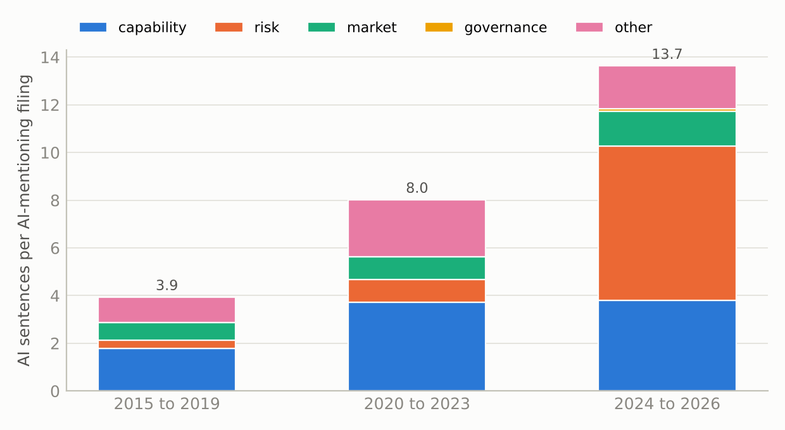
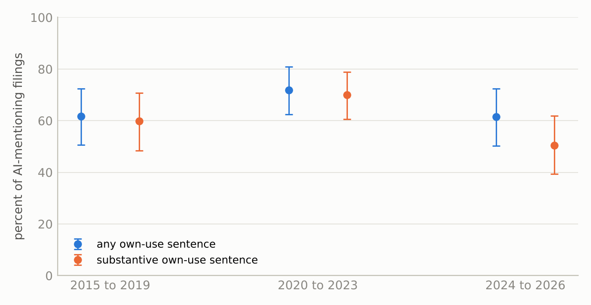

## Abstract

The share of Form 10-K filings containing the phrase "artificial intelligence" rose
from 0.5 percent in 2015 to 49.2 percent in 2025. I classify all 2,242 AI sentences
in 315 sampled filings by what they say and whether they assert that the filer
itself uses AI. Capability claims per AI-mentioning filing roughly doubled, from 1.8
to 3.8, but risk-factor sentences rose from 0.3 to 6.4 and account for 63 percent of
the added volume, so the risk share of a filing's AI language went from 12 to 63
percent. The share of AI-mentioning filings with a substantive own-use statement fell
from 60 to 51 percent, an imprecise decline, and conditional on how much AI text a
filing contains, recent filers are much less likely to assert use. The ratio of
mention counts to substantive own-use assertions is about 1.7 before 2020 and 2.0
since 2024. Sentences were labelled by blinded language-model raters, validated
against known answers and a blinded model review but not yet against human coders,
for whom a validation sample is published. Language models also wrote the code and
drafted this paper under the author's direction, as the AI-use statement describes.

**Keywords:** artificial intelligence, corporate disclosure, 10-K, risk factors,
textual analysis, boilerplate, AI washing.

## 1. Introduction

Counting the annual reports that mention artificial intelligence is the cheapest
available indicator of how far AI has spread through public companies. The filings
are public, the phrase is unambiguous, and EDGAR's full-text search returns the count
in a second. The count has risen in a way that looks like a diffusion curve: fewer
than one 10-K in two hundred contained the phrase in 2015, one in two did in 2025,
and three in five have so far in 2026 (Table 1). Published adoption measures built
from corporate text, such as the AI-disclosure measures of Barrios et al. (2025) and
the talk-versus-walk comparison of Li (2025), are more careful than a raw count, but
they share its premise that what firms write about AI is informative about what they
do with it.

This paper asks what the rising count is made of. A filing can mention AI to describe
its own product, to warn that AI is a risk, to say competitors are using it, to
describe board oversight, or in passing. Only the first, and some risk sentences that
mention the filer's use along the way, say anything about adoption. If the growth
comes from the other kinds of sentence, the count misstates adoption, and it misstates
it differently in different years.

I draw a random sample of AI-mentioning 10-Ks for every year from 2015 to 2026,
extract every AI sentence, and classify each one by what it says and by whether it
asserts that the filer itself uses AI. Three findings follow.

First, the growth in AI language is mostly risk language added on top of product
language rather than replacing it. Capability claims per AI-mentioning filing
roughly doubled between 2015 to 2019 and 2024 to 2026, while risk-factor sentences
rose nineteen-fold and supplied 63 percent of the added volume. By 2024 to 2026 nearly
half of all AI sentences sit in Item 1A, the risk-factor section, against 14 percent
before 2020.

Second, the filers who mention AI are no more likely to state their own use of it
than before, and on a stricter definition they are less likely. About three in five
AI-mentioning filings contain some own-use sentence in every era, but the late-era
figure leans on risk sentences that mention use in passing. Counting only
substantive own-use statements, the share falls from 60 percent before 2020 to 51
percent since 2024, and holding constant how much AI text a filing contains, a recent
filing is far less likely to assert use than an earlier one with the same amount.

Third, verbatim boilerplate is rare but concentrated. Of capability sentences, none
is shared word for word with five or more other registrants, against 18 percent of
risk sentences, and the share of a filing's AI language that is copied across filers
rose from zero before 2020 to 12 percent since 2024.

The study extends a pilot on 60 filings from 2025 (Shah 2026). Its hypotheses and
sampling plan were preregistered before any filing was drawn, and every sentence,
label, prompt and line of code is public. Section 7 lists where the analysis departs
from that plan.

## 2. Related work

Textual analysis of filings has long warned that a word count built for one purpose
misleads when used for another (Loughran and McDonald 2011, 2016, Gentzkow, Kelly and
Taddy 2019). Several strands bear directly on this paper.

**Length, boilerplate and stickiness.** Li (2008) linked annual-report readability to
earnings persistence. Dyer, Lang and Stice-Lawrence (2017) showed that 10-K length,
boilerplate, stickiness and redundancy rose from 1996 to 2013, with risk factors among
the few topics that account for most of the growth, and Cazier and Pfeiffer (2016)
decomposed 10-K length. Lang and Stice-Lawrence (2015) measured boilerplate from
phrases common across filings. Brown and Tucker (2011) and Cohen, Malloy and Nguyen
(2020) studied year-over-year change in filing text and showed that revisions are
rare and informative. Hanley and Hoberg (2010) separated standard from informative content in IPO
prospectuses, the closest precedent for the distinction between template and
substance that this paper draws for AI language.

**Risk factors.** Mandated risk factors carry firm-specific information on average
(Campbell et al. 2014, Kravet and Muslu 2013), but generic risk language is
discounted relative to specific language (Hope, Hu and Lu 2016). Redigolo and
Marcarini (2026) find that Item 1A text became more standardised after ChatGPT. Two
regulatory changes matter for interpreting any post-2020 shift in risk language: the
2020 amendments to Regulation S-K, which discouraged generic risk factors and required
them to be grouped under a "General Risk Factors" caption (U.S. Securities and
Exchange Commission 2020), and the 2023 cybersecurity rule, which added Item 1C for
fiscal years ending on or after 15 December 2023 (U.S. Securities and Exchange
Commission 2023).

**Text-based firm measures and AI.** Hassan et al. (2019) and Florackis et al. (2023)
built firm-level risk exposures from text and validated them against outcomes, the
standard a text measure should meet. For AI specifically, Babina et al. (2024) measure
investment from employee resumes, Eisfeldt, Schubert and Zhang (2023) from
occupational exposure, and Kalyani et al. (2025) trace how new technologies diffuse
across firms. Li (2025) finds that AI talk on earnings calls does
not predict AI hiring, while Barrios et al. (2025) find that AI disclosures in 10-Ks
and calls do predict later efficiency and patents. Juma'h (2026) documents vague and
promotional AI language in 10-Ks, and Zhang and Rivera (2026) and Ofir (2026) treat AI
washing as a governance and a legal problem. Census Bureau surveys measure AI use
directly (Bonney et al. 2024, McElheran et al. 2024). This paper does not propose a
new adoption measure. It decomposes the raw count that these measures refine.

**Language models as annotators.** Generative models can match or beat crowd coders on
annotation (Gilardi, Alizadeh and Kubli 2023), and de Kok (2025) gives a framework for
their use in accounting research. Their labels contain errors that bias downstream
estimates unless corrected with a human-coded subsample (Egami et al. 2023,
Angelopoulos et al. 2023). That correction is the main piece of work this paper has
not yet done, and Section 6 says what it requires.

## 3. Data

### 3.1 The frame and the denominator

For each calendar year from 2015 to 2026 the frame is every original Form 10-K (not an
amendment) whose main document contains the exact phrase "artificial intelligence" in
EDGAR full-text search, counted by filing year and running through 18 October 2026.
Exhibit-only matches are excluded. The denominator is every original 10-K in the EDGAR
full index for the year. Across the twelve years the frame holds 13,586 of 82,684
10-Ks. Years are years of filing, so 2026 contains real annual reports already on
EDGAR, mostly for fiscal 2025. Because most 10-Ks are filed in the first quarter, 2026
is nearly complete, and its share will move slightly by December.

| year | frame | all 10-Ks | raw share |
|---|---:|---:|---:|
| 2015 | 38 | 7,659 | 0.50% |
| 2016 | 45 | 7,259 | 0.62% |
| 2017 | 110 | 6,984 | 1.58% |
| 2018 | 271 | 6,827 | 3.97% |
| 2019 | 400 | 6,660 | 6.01% |
| 2020 | 511 | 6,508 | 7.85% |
| 2021 | 734 | 6,933 | 10.59% |
| 2022 | 1,071 | 7,538 | 14.21% |
| 2023 | 1,206 | 7,118 | 16.94% |
| 2024 | 2,324 | 6,631 | 35.05% |
| 2025 | 3,162 | 6,431 | 49.17% |
| 2026 to 18 Oct | 3,714 | 6,136 | 60.53% |

Table 1. Original 10-K filings whose main document contains "artificial
intelligence", all original 10-K filings, and the raw mention share, by calendar year
of filing.

The frame is defined by one phrase. A filing that writes "machine learning" or "AI"
but never "artificial intelligence" is outside it, so every adoption share below is a
share of filings that use the phrase, and a lower bound on the share of all 10-Ks
that discuss AI in any words.

### 3.2 The sample and the weights

Within each year the frame was collapsed to one filing per registrant and a random
sample was drawn under a fixed seed: 30 filings in each of 2015 to 2017 and 25 in each
year from 2018 to 2026, 315 filings from 281 registrants. The draw is far from
proportional. It takes 30 of 36 registrants in 2015 and 25 of 3,710 in 2026, so every
estimate that pools years weights each sampled filing by its year's registrant count
divided by the number drawn, and the bootstrap resamples filings within year. The
eras are therefore dominated by their later years: 2018 and 2019 carry 78 percent of
the weight of 2015 to 2019, and 2025 and 2026 carry 75 percent of 2024 to 2026.
Weighted estimates describe the population of AI-mentioning filings, not the average
year. Unweighted estimates are published beside them in the repository.

### 3.3 Extraction

Each main document was stripped of markup and split into sentences by a fixed
splitter. A sentence entered the corpus if it matched the AI term list, was 60 to
1,200 characters long, and was under a quarter digits. All 315 filings yielded 2,590
candidate sentences. Four sampled registrants carry the letters AI in their own names,
one of which, C3.ai in 2023, contributed 448 candidates. A name screen and a blinded
read removed 348 sentences that mention AI only through a registrant's name, leaving
2,242 sentences in 313 filings, a median of 3 per filing. Each sentence was also
tagged with the 10-K item it sits in, from the item headings in the document.

## 4. Method

### 4.1 What each sentence is judged on

Each sentence receives a class and an own-use judgement.

The **class** is one of five. `capability` means the sentence says the filer's own
product, service or operation uses AI and attributes a capability or benefit to it.
`risk` is risk-factor language about AI. `market` describes AI in the industry or at
competitors. `governance` describes policy or oversight of AI. `other` covers
definitions, cross-references and everything else, including a sentence that says the
filer uses AI without saying what the AI achieves.

**Own use** is true when the sentence states that the filer itself currently uses,
offers, develops or is implementing AI, whether or not a benefit is attributed, and
false for hypothetical use, statements about others, definitions and risk language
that does not assert actual use. A risk sentence that asserts use in passing, "our
use of AI in underwriting exposes us to model risk", is true.

Because own use can be carried by a risk sentence, the paper reports two filing-level
indicators. A filing has **any own-use statement** if at least one of its sentences is
coded own use. It has a **substantive own-use statement** if at least one own-use
sentence is not risk-factor language and is not shared verbatim with five or more
other registrants. The second definition was added after the referee review described
in Section 7 and is exploratory.

### 4.2 The estimands

For year $t$, let $m_t$ be the share of all 10-Ks in the frame, and let $p_t$ be the
design-weighted share of frame filings with a substantive own-use statement. The share
of all 10-Ks that make such a statement is $a_t = m_t \, p_t$, and the
**mention-to-assertion ratio** is $m_t / a_t = 1/p_t$, the factor by which the raw
count exceeds the count of filings asserting use. The ratio is reported for both
own-use definitions. It measures statements in filings, not adoption. A filer can use
AI without saying so, and a statement is not verified.

Composition is reported two ways: the mean number of AI sentences per filing in each
class, which shows what was added, and the share of a filing's AI sentences in each
class, averaged over filings, which shows the resulting mix. Both are design-weighted.

### 4.3 Raters

The sentences were labelled by language models, not people. Each sentence was shown,
with the registrant's name and ticker redacted and in an order shuffled across
filings and years, to two of six independent instances of the same commercial
language model, each with no shared context and the literal prompt committed in
`docs/RATER_PROMPT.md`. The 155 sentences on which the two passes disagreed were rated
a third time, blind, by a larger model from the same family, mixed with 155 agreed
sentences. The label used throughout is the majority of three. Thirty sentences with
known answers from the pilot's calibration set were inserted unmarked. Their answers
had been fixed by a blinded model review in the pilot, not by a human, so they test
consistency with the pilot rather than correctness.

A seeded sample of 120 sentences, stratified by class and era, with ten duplicates,
was then re-read blind by the largest model in the same family, which also
orchestrated the study. Its verdicts give a survival rate for each class and each
own-use value, which is used to correct the composition shares and, by simulation, the
filing-level fractions.

All raters, the third pass and the calibration reviewer come from one model family.
Their errors may be correlated, and agreement among them measures consistency, not
validity. Section 6 describes the human validation that addresses this.

### 4.4 Phrase reuse

For each sentence, the twelve consecutive words starting at the first AI term were
searched as an exact phrase across all 10-K filings since 2001, and the number of
other registrants whose filings contain the phrase was recorded. A sentence is
flagged as boilerplate when five or more other registrants have used its phrase. The
window was fixed by a pilot before any corpus sentence was searched, and an
eight-word run is reported as a check. The search covers all years, so a flagged
sentence may have been copied from a template or may have become one later.

### 4.5 Statistics

Intervals are 95 percent percentile bootstrap intervals from 10,000 replicates that
resample filings within year, except where noted. Regressions are logistic, weighted
by the design weights with each filing counted equally within year, and cluster
standard errors by registrant.

## 5. Results

### 5.1 The labels are consistent with each other

The two blind passes gave the same class on 94.6 percent of sentences (Krippendorff's
alpha 0.924) and the same own-use judgement on 97.7 percent (alpha 0.952). Of the 121
class disagreements, 73 were capability against other. All 60 judgements on the 30
known-answer sentences matched. In the blinded calibration, 90 percent of majority
labels survived: risk 96 percent, other 96, market 89, capability 87 and governance 5
of 8. All four overturned capability labels went to other. Own-use labels survived at
94 percent when true and 89 percent when false. These are model-on-model checks and
are a floor, not a validation.

### 5.2 Risk language was added on top

{width=88%}

Figure 1 and Table 2 show what an AI-mentioning filing contains. In 2015 to 2019 it
held 3.9 AI sentences, 1.8 of them capability claims and 0.3 risk sentences. In 2024
to 2026 it holds 13.7, of which 3.8 are capability claims and 6.4 are risk sentences.
Capability claims per filing roughly doubled, and almost all of that happened by 2020
to 2023. Risk sentences rose nineteen-fold, almost all after 2023. Of the 9.7
sentences added between the first and last era, 6.1 are risk (63 percent), 2.0
capability (21 percent), 0.7 market and 0.7 other.

| mean per filing | 2015 to 2019 | 2020 to 2023 | 2024 to 2026 |
|--------------------------|--------------------:|--------------------:|--------------------:|
| capability | 1.77 [1.21, 2.41] | 3.72 [2.20, 6.08] | 3.81 [2.14, 5.78] |
| risk | 0.35 [0.14, 0.66] | 0.97 [0.52, 1.49] | 6.44 [4.49, 8.79] |
| market | 0.75 [0.47, 1.08] | 0.96 [0.43, 1.77] | 1.46 [0.59, 2.77] |
| governance | 0.00 | 0.00 | 0.11 [0.04, 0.20] |
| other | 1.06 [0.58, 1.75] | 2.37 [0.94, 4.29] | 1.79 [1.12, 2.55] |
| all AI sentences | 3.94 [2.82, 5.57] | 8.03 [4.71, 13.16] | 13.66 [9.33, 18.61] |
| share that is risk, percent | 12.0 [5.7, 19.6] | 18.4 [12.0, 25.6] | 63.0 [55.4, 70.4] |
| share that is capability, percent | 40.6 [31.3, 50.2] | 43.1 [35.5, 50.9] | 15.7 [10.8, 21.1] |
| filings, sentences | 139, 490 | 99, 735 | 75, 1,012 |

Table 2. AI sentences per AI-mentioning filing by class, and the share of a filing's
AI sentences in the two main classes, averaged over filings. Design-weighted,
majority-of-three labels, 95 percent bootstrap intervals. The 2020 to 2023 means
include the C3.ai filing, with 154 sentences, which widens their intervals.

The share of a filing's AI language that is risk therefore rose from 12 to 63 percent
and the capability share fell from 41 to 16 percent, but the fall in the capability
share is dilution, not substitution. A reader who sees only the shares would conclude
that firms stopped describing their AI. They did not. They kept describing it and
added warnings.

The shift is a step, not a trend. In a sentence-level regression, the odds that an AI
sentence is risk language are 12.5 times higher in filings made from 2024 onward than
in 2015 to 2019 (interval 5.8 to 27.3), while 2020 to 2023 does not differ
detectably from the first era. Calibration correction does not change this: the
corrected rise in the risk share is 49.8 points (39.0 to 60.1).

### 5.3 Where the sentences sit

The item tags locate the change. Before 2020, 64 percent of AI sentences were in
Item 1, the business description, and 14 percent in Item 1A, risk factors. In 2024 to
2026, 40 percent are in Item 1 and 47 percent in Item 1A, and 83 percent of the AI
sentences in Item 1A are risk-class. The new cybersecurity item, Item 1C, holds 0.5
percent of late-era AI sentences, so the 2023 cybersecurity rule is not where the AI
language went. The 2020 Regulation S-K amendments cannot explain the timing either,
since the risk share in 2020 to 2023 is close to its pre-2020 level and the jump comes
in 2024, with the first annual reports written after the release of ChatGPT. The
design cannot separate that release from other changes in 2023, including the
Commission's growing attention to AI claims (U.S. Securities and Exchange Commission
2024, 2025).

### 5.4 Fewer filers assert use than the count implies

{width=86%}

Table 3 and Figure 2 give the filing-level results. The share of AI-mentioning filings
with any own-use sentence is 61.6, 71.9 and 61.5 percent across the three eras, with
no trend. That stability is partly made of risk language: the share of filings whose
only own-use sentences are risk sentences rose from 1.9 percent before 2020 to 11.0
percent since 2024. On the substantive definition the share is 59.8, 70.0 and 50.5
percent, a late-minus-early fall of 9.3 points whose interval, from 24.8 down to 6.5
up, includes zero.

| | 2015 to 2019 | 2020 to 2023 | 2024 to 2026 |
|--------------------------------|--------------------:|--------------------:|--------------------:|
| any own-use statement, percent | 61.6 [50.5, 72.5] | 71.9 [62.5, 80.9] | 61.5 [50.3, 72.4] |
| substantive own-use statement, percent | 59.8 [48.3, 70.8] | 70.0 [60.6, 78.9] | 50.5 [39.4, 61.8] |
| own use only in risk sentences, percent | 1.9 [0.0, 5.6] | 2.0 [0.0, 5.3] | 11.0 [4.2, 18.8] |
| mention-to-assertion ratio, any | 1.62 [1.38, 1.98] | 1.39 [1.24, 1.60] | 1.63 [1.38, 1.99] |
| mention-to-assertion ratio, substantive | 1.67 [1.41, 2.07] | 1.43 [1.27, 1.65] | 1.98 [1.62, 2.54] |

Table 3. Filing-level own-use statements among AI-mentioning filings, design-weighted,
with 95 percent bootstrap intervals, and the mention-to-assertion ratio of Section
4.2. Ratio intervals are the reciprocals of the fraction intervals.

The flat headline fraction also hides a length effect. A filing with more AI sentences
has more chances to contain an own-use sentence, and late-era filings have three times
as many. Holding the number of AI sentences constant, the odds that a 2024 to 2026
filing contains any own-use sentence are 0.21 times those of a 2015 to 2019 filing
(interval 0.07 to 0.58). Among filings with one or two AI sentences, 42 percent made an
own-use statement before 2020 and 14 percent since 2024. Among those with three to
five, the figures are 81 and 52 percent. The proportion of AI sentences that state own
use fell from 60 to 50 percent. A recent filing that mentions AI briefly is now most
likely to be warning about it.

Rater error matters here because one false own-use label is enough to count a filing.
Simulating the calibration error rates through to the filing level, with their
uncertainty, moves the any-own-use fractions up to 67.9, 75.7 and 70.9 percent. Noise
of that size raises levels by six to nine points in every era and is larger where
filings are longer, so it biases toward finding no decline, not toward finding one.

### 5.5 The mention-to-assertion ratio by year

| year | filings | raw share | any own use | substantive | asserting use, share of all 10-Ks | ratio |
|------|----:|-----:|-----:|-----:|------------------------:|----:|
| 2015 | 29 | 0.50 | 79.3 | 79.3 | 0.4 [0.3, 0.5] | 1.26 |
| 2016 | 30 | 0.62 | 73.3 | 73.3 | 0.5 [0.4, 0.5] | 1.36 |
| 2017 | 30 | 1.58 | 56.7 | 56.7 | 0.9 [0.6, 1.2] | 1.76 |
| 2018 | 25 | 3.97 | 56.0 | 56.0 | 2.2 [1.4, 3.0] | 1.79 |
| 2019 | 25 | 6.01 | 64.0 | 60.0 | 3.8 [2.6, 5.0] | 1.56 |
| 2020 | 24 | 7.85 | 66.7 | 62.5 | 5.2 [3.8, 6.6] | 1.50 |
| 2021 | 25 | 10.59 | 76.0 | 76.0 | 8.0 [6.4, 9.7] | 1.32 |
| 2022 | 25 | 14.21 | 76.0 | 76.0 | 10.8 [8.5, 13.1] | 1.32 |
| 2023 | 25 | 16.94 | 68.0 | 64.0 | 11.5 [8.1, 14.2] | 1.47 |
| 2024 | 25 | 35.05 | 64.0 | 56.0 | 22.4 [15.4, 28.0] | 1.56 |
| 2025 | 25 | 49.17 | 52.0 | 40.0 | 25.6 [15.7, 35.4] | 1.92 |
| 2026 | 25 | 60.53 | 68.0 | 56.0 | 41.2 [29.1, 50.8] | 1.47 |

Table 4. By year: filings drawn, the raw mention share of all 10-Ks, the percent of
sampled AI-mentioning filings with any and with a substantive own-use statement, the
estimated share of all 10-Ks with any own-use statement, with its bootstrap interval,
and the ratio of the raw share to it. Shares of all 10-Ks are percentages.

With 25 filings a year, yearly fractions carry Wilson intervals 28 to 37 points wide,
and the yearly ratio ranges from 1.26 to 1.92. The eras are the usable summary. A
single year's corrected share, such as the 25.6 percent of 2025 10-Ks estimated to
contain an own-use statement, should not be read on its own.

### 5.6 Verbatim reuse is rare and is risk language

Of the 2,166 sentences whose phrases the search returned, 84.8 percent share their
twelve-word phrase with no other registrant. None of 864 capability sentences is
shared with five or more others, against 104 of 565 risk sentences (18.4 percent).
The flag identifies risk language with 96 percent precision and 18 percent recall,
both measured against the model labels. The flagged share of a filing's AI sentences
was 0.0 percent before 2020, 2.8 percent in 2020 to 2023 and 12.3 percent since 2024
(interval 7.4 to 17.7). The most widely copied sentences are generic risk factors:
the inability to use generative AI (87 other registrants), deficient or biased AI
output (78), competitors adopting AI faster (74), AI ethics controversy (68) and the
cost of AI regulation (63). The eight-word window raises the flagged share only from
5.0 to 6.2 percent.

Firms also repeat themselves. For the 34 pairs of filings by the same registrant drawn
in two years, a median of one year apart, 27 percent of the later filing's AI
sentences reuse at least half of their eight-word sequences from the earlier filing's
AI sentences.

So AI language is mostly not boilerplate in the verbatim sense that Lang and
Stice-Lawrence (2015) measure, and the generic risk factors that are copied are a
small part of the risk language that was added. Most of the new risk text is written
for the filing, even when it says much the same thing as other filings.

### 5.7 Sector, size and replication

Pooling years with the design weights, 85.7 percent of technology registrants'
AI-mentioning filings state own use (interval 76.3 to 94.0), against 39.5 percent in
finance and real estate, 69.8 percent in healthcare and 63.2 percent elsewhere. Sectors
are SIC ranges: technology is 3570 to 3579, 3660 to 3679 and 7370 to 7379,
healthcare is 2833 to 2836, 3826 to 3851, 5912 and 8000 to 8099, and finance and real
estate is 6000 to 6799. Technology registrants fell from 42 percent of the frame
before 2020 to 16 percent since 2024, which contributes to the late-era decline in own
use. Larger registrants, above about one billion dollars in assets, devote 57.7
percent of their AI sentences to risk against 34.5 percent at smaller ones, partly
because smaller reporting companies need not provide Item 1A.

For 2025, the 25 filings here give a sentence-weighted risk share of 49.5 percent
(37.6 to 64.8) against the pilot's 65.5 percent, just outside the interval, and a
capability share of 28.5 percent (11.0 to 42.5) against 13.5. On the filing-weighted
basis used in this paper the 2025 figures are 67.5 and 11.2 percent. The two studies
agree only loosely, as 25 filings would lead one to expect.

### 5.8 Preregistered predictions

Seven predictions were registered. Each is classified as held (point estimate in the
predicted direction, interval excluding the null), held on the point estimate only,
or failed on the point estimate.

1. The risk share is higher in 2024 to 2026 than in 2015 to 2019: held, +51.1 points
   [40.5, 60.8].
2. The own-use share of a filing's AI sentences is lower: held, −20.3 points
   [−31.9, −8.3]. Weighting sentences equally, the interval includes zero.
3. Fewer than 60 percent of late-era AI-mentioning filings contain any own-use
   sentence: failed on the point estimate, 61.5 percent [50.4, 72.2]. On the
   substantive definition the figure is 50.5 percent, but that definition was not
   registered.
4. Risk sentences are reused at least three times as much as capability sentences by
   median, and flagged at least twice as often: held on the second criterion (18.4
   against 0 percent). The first cannot be evaluated because both medians are zero.
5. The flagged share rises: held, +12.3 points [7.4, 17.7].
6. The mention-to-assertion ratio is larger in the last era: held on the point
   estimate only, 1.63 against 1.62, interval on the difference [−0.43, 0.43]. On the
   substantive definition the ratio rises to 1.98, but again that was not registered.
7. Technology registrants have a higher own-use rate: held, +26.9 points [13.8,
   39.4].

## 6. Limitations and what would fix them

**No human has validated the labels.** Every check in Section 5.1 is a model checking
models from the same family, and the calibration reviewer orchestrated the study. A
blinded sample of 300 sentences, stratified to oversample the capability-other and
risk-own-use boundaries, is published with a coding guide in
`data/human_validation/` and `docs/HUMAN_CODING_GUIDE.md`, together with a script that
reports human-human agreement, model-human agreement and per-class precision and
recall. Until two human coders complete it, the levels in this paper should be read
as model estimates. The natural next step after that is to correct the estimates with
the human subsample (Egami et al. 2023, Angelopoulos et al. 2023) and to cross-check a
subsample with a model from a different developer.

**The sample is thin.** Twenty-five filings a year support era comparisons, not
single-year estimates. Extending the draw to at least 100 filings a year from 2022 is
the cheapest improvement to every interval in Tables 3 and 4.

**The frame is one phrase.** Filings that discuss AI only as "machine learning" or "AI"
are excluded. EDGAR returns 2,050 10-K hits for "machine learning" in 2026 against
3,883 for "artificial intelligence", and the overlap was not measured.

**Statements are not adoption.** The paper measures what filings say. Whether the
statements are true, and whether the added risk language carries information as
Campbell et al. (2014) found for risk factors generally or is discounted as Hope, Hu
and Lu (2016) found for generic ones, needs outcome data this design does not have.

**Timing is not identified.** The 2024 step coincides with the first post-ChatGPT
annual reports, with growing regulatory attention to AI claims, and with the
cybersecurity rule. The item tags rule out Item 1C as the channel, but the design
cannot separate the others.

**Reuse is measured across all years.** A flagged sentence may be a template or may
have become one, and 3.5 percent of phrases failed to find their own filing, a
normalisation failure that biases reuse counts down.

**Blinding leaked slightly.** Period cues such as "generative AI" appear in 6.7 percent
of sentences and a name fragment survived redaction in 3.7 percent. Agreement was not
higher on them, but whether the cues shifted labels toward risk was not tested.

## 7. Departures from the preregistration

The preregistration, sampling, ratings and first analysis were all completed on 18
October 2026, and several choices that shape the reported magnitudes were made after
the ratings were seen. Table 5 lists them.

| change | when | effect |
|---|---|---|
| filings rather than sentences weighted equally in composition shares | after ratings | larger risk shift (51 against 38 points sentence-weighted); both reported |
| design weights for pooled and era estimates | after the first draft, on an independent check | narrows Prediction 6 from 1.63 against 1.51 unweighted to 1.63 against 1.62 |
| batches of 50 rather than about 40 sentences | during rating | none expected |
| per-class calibration correction applied to filing-level fractions by simulation rather than analytically | second revision | raises levels six to nine points, no change in direction |
| mean counts per filing, substantive own use, length-adjusted model, item tags, within-firm reuse, post-2023 regression | second revision, after a referee-style review | exploratory, reframes the headline from substitution to addition |
| sector ordering under the raw measure and a sector comparison with Census data | registered, not done | needs the sector of every 10-K filer |

Table 5. Departures from the preregistered plan. The dated amendments are in
`docs/PREREGISTRATION.md`.

## 8. Conclusion

The number of 10-Ks that mention artificial intelligence grew a hundredfold in a
decade, and most of the language that came with it after 2023 is risk-factor text.
That text did not replace what firms say about their own AI. Capability claims per
filing doubled and then held steady while warnings were stacked on top, until nearly
half of all AI sentences sat in Item 1A. The share of AI-mentioning filers that make a
substantive statement about their own use, meanwhile, has not grown and may have
fallen, and a recent filing with little AI text is now most often a filing that only
warns.

For anyone using the count, the practical rule is that the raw number of filings
mentioning AI exceeds the number substantively asserting use by a factor of about 1.4
to 1.7 before 2024 and about 2.0 since, with intervals that make any single year
unreliable, and that the volume of AI text has become mainly a measure of risk-factor
drafting. Both statements rest on model labels that still await the human validation
the paper publishes the materials for.

## AI-use statement

Language models were used throughout this project. In the measurement, they served as
the sentence raters, the third-pass rater, the term-audit reader and the calibration
reviewer, as Section 4.3 describes. Beyond the measurement, an AI agent working under
the author's direction proposed the research design, wrote the data-collection and
analysis code, drafted the preregistration and this paper, searched the literature
and checked each reference against its DOI record, and an independent AI reviewer
critiqued the draft. The author selected the research question, directed the work,
and takes responsibility for the content. The models and versions used for each role
are recorded and available from the author.

## Data and code

Data, code, the preregistration and its amendments, the rater prompt, every sentence
and label, and the human-validation materials are at
`https://github.com/ishaanshah101/ai-disclosure-trend-audit`. `src/analyze.py` and
`src/revision2.py` produce every number in the paper, and `src/verify_paper.py`
checks the numbers quoted here against their output.

## References

Angelopoulos, A. N., Bates, S., Fannjiang, C., Jordan, M. I., and Zrnic, T. (2023).
Prediction-powered inference. *Science*, 382(6671), 669–674.

Babina, T., Fedyk, A., He, A. X., and Hodson, J. (2024). Artificial intelligence, firm
growth, and product innovation. *Journal of Financial Economics*, 151, 103745.

Barrios, J. M., Campbell, J. L., Johnson, R. G., and Liu, C. (2025). Signals or smoke?
The determinants and informativeness of corporate artificial intelligence (AI)
disclosures. SSRN working paper 5133107.

Bonney, K., Breaux, C., Buffington, C., Dinlersoz, E., Foster, L. S., Goldschlag, N.,
Haltiwanger, J. C., Kroff, Z., and Savage, K. (2024). Tracking firm use of AI in real
time: a snapshot from the Business Trends and Outlook Survey. NBER Working Paper 32319.

Brown, S. V., and Tucker, J. W. (2011). Large-sample evidence on firms' year-over-year
MD&A modifications. *Journal of Accounting Research*, 49(2), 309–346.

Campbell, J. L., Chen, H., Dhaliwal, D. S., Lu, H., and Steele, L. B. (2014). The
information content of mandatory risk factor disclosures in corporate filings. *Review
of Accounting Studies*, 19(1), 396–455.

Cazier, R. A., and Pfeiffer, R. J. (2016). Why are 10-K filings so long? *Accounting
Horizons*, 30(1), 1–21.

Cohen, L., Malloy, C., and Nguyen, Q. (2020). Lazy prices. *The Journal of Finance*,
75(3), 1371–1415.

de Kok, T. (2025). ChatGPT for textual analysis? How to use generative LLMs in
accounting research. *Management Science*, 71(9), 7888–7906.

Dyer, T., Lang, M., and Stice-Lawrence, L. (2017). The evolution of 10-K textual
disclosure: evidence from Latent Dirichlet Allocation. *Journal of Accounting and
Economics*, 64(2–3), 221–245.

Egami, N., Hinck, M., Stewart, B. M., and Wei, H. (2023). Using imperfect surrogates
for downstream inference: design-based supervised learning for social science
applications of large language models. *Advances in Neural Information Processing
Systems*, 36, 68589–68601.

Eisfeldt, A. L., Schubert, G., and Zhang, M. B. (2023). Generative AI and firm values.
NBER Working Paper 31222.

Florackis, C., Louca, C., Michaely, R., and Weber, M. (2023). Cybersecurity risk.
*The Review of Financial Studies*, 36(1), 351–407.

Gentzkow, M., Kelly, B., and Taddy, M. (2019). Text as data. *Journal of Economic
Literature*, 57(3), 535–574.

Gilardi, F., Alizadeh, M., and Kubli, M. (2023). ChatGPT outperforms crowd workers for
text-annotation tasks. *Proceedings of the National Academy of Sciences*, 120(30).

Hanley, K. W., and Hoberg, G. (2010). The information content of IPO prospectuses.
*The Review of Financial Studies*, 23(7), 2821–2864.

Hassan, T. A., Hollander, S., van Lent, L., and Tahoun, A. (2019). Firm-level
political risk: measurement and effects. *The Quarterly Journal of Economics*, 134(4),
2135–2202.

Hope, O.-K., Hu, D., and Lu, H. (2016). The benefits of specific risk-factor
disclosures. *Review of Accounting Studies*, 21(4), 1005–1045.

Juma'h, A. H. (2026). Artificial intelligence disclosure practices in US 10-K filings:
accounting standards, signalling incentives and reporting quality. *Journal of Applied
Accounting Research*, ahead of print.

Kalyani, A., Bloom, N., Carvalho, M., Hassan, T., Lerner, J., and Tahoun, A. (2025).
The diffusion of new technologies. *The Quarterly Journal of Economics*, 140(2),
1299–1365.

Kravet, T., and Muslu, V. (2013). Textual risk disclosures and investors' risk
perceptions. *Review of Accounting Studies*, 18(4), 1088–1122.

Lang, M., and Stice-Lawrence, L. (2015). Textual analysis and international financial
reporting: large sample evidence. *Journal of Accounting and Economics*, 60(2–3),
110–135.

Li, B. (2025). AI washing. Working paper, University of Florida, August 2025.

Li, F. (2008). Annual report readability, current earnings, and earnings persistence.
*Journal of Accounting and Economics*, 45(2–3), 221–247.

Loughran, T., and McDonald, B. (2011). When is a liability not a liability? Textual
analysis, dictionaries, and 10-Ks. *The Journal of Finance*, 66(1), 35–65.

Loughran, T., and McDonald, B. (2016). Textual analysis in accounting and finance: a
survey. *Journal of Accounting Research*, 54(4), 1187–1230.

McElheran, K., Li, J. F., Brynjolfsson, E., Kroff, Z., Dinlersoz, E., and Foster, L.
(2024). AI adoption in America: who, what, and where. *Journal of Economics &
Management Strategy*, 33(2), 375–415.

Ofir, M. (2026). AI washing. *American Business Law Journal*, 63(3), 193–233.

Redigolo, G., and Marcarini, N. (2026). Generative AI and risk perception: evidence
from risk-factor disclosures. SSRN working paper 7201722.

Shah, I. (2026). One checkable claim: what public companies actually say about their
own AI, and whether anyone could verify it.
`https://github.com/ishaanshah101/ai-claims-audit`.

U.S. Securities and Exchange Commission (2020). Modernization of Regulation S-K Items
101, 103, and 105. Release No. 33-10825, effective 9 November 2020.

U.S. Securities and Exchange Commission (2023). Cybersecurity risk management,
strategy, governance, and incident disclosure. Release No. 33-11216.

U.S. Securities and Exchange Commission (2024). SEC charges two investment advisers
with making false and misleading statements about their use of artificial
intelligence. Press release 2024-36, 18 March 2024.

U.S. Securities and Exchange Commission (2025). In the matter of Presto Automation
Inc. Order instituting cease-and-desist proceedings, Securities Act Release No. 11352,
14 January 2025.

Zhang, Y., and Rivera, M. (2026). AI washing as an IT governance problem: strategic
ambiguity in corporate disclosures and the consequences of regulatory enforcement.
SSRN working paper 6959279.
